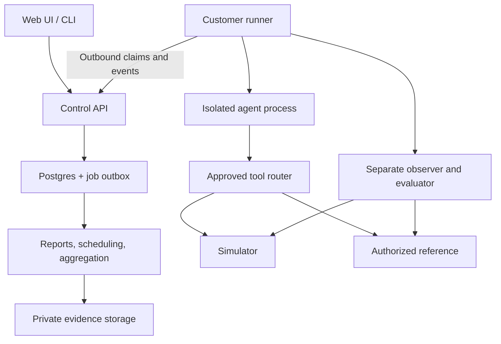

# Susanoo Architecture and Build Plan

## 1. Instructions for the coding agent

Build Susanoo as a working product from this specification. Audit the existing repository first, preserve working components, then implement and test every release group below. Do not stop at a scaffold, UI mockup, plan, or a single happy-path demo. This document specifies the full build, including the simulator, broad agent intake, evaluator checks, repair workflow, recurring evaluation, and voice/media extension.

The companion `Susanoo_PRD.pdf` defines product requirements. This document defines the implementation. The expanded scope here supersedes the earlier PRD's HTTP/Python-only intake and deferred simulator. Delivery groups are dependency order, not permission to omit later groups. Provider credentials and customer approval can gate live activation; they do not excuse unimplemented application code or untested protocol contracts.

1. Read repository instructions, inspect git status, identify the stack, migrations, existing tests and implemented features. Do not overwrite unrelated work or assume previously reported features work.
2. Write `docs/implementation-status.md`: requirement ID, existing implementation, missing work, test, status. Keep it current across sessions.
3. Reuse a sound existing stack. If no suitable application exists, use the default stack in section 5. Record any substitution and preserve the behavior specified here.
4. Build vertical slices. Each slice must work through UI, API, persistence, runner and verification before moving on.
5. Continue through all delivery groups. Fix discovered failures, run relevant checks and finish the final acceptance suite. Do not ask the user to choose routine libraries or file layouts.
6. Use synthetic data, local services and fake provider servers when customer credentials are unavailable. Implement actual provider clients against documented contracts; label live integration validation separately. Never replace a required connector with a permanently hardcoded demo.
7. Never run customer code in the control-plane process. Never treat repository access as permission to execute production actions, expose secrets, publish a PR or deploy changes.
8. Stop only for a genuinely unavailable external dependency or authorization needed for a live operation. Complete independent work first and document the exact remaining action.
9. Final delivery must include runnable code, migrations, pinned dependencies, seed data, adapters, tests, deployment files, operator documentation and an honest completion report.

## 2. Product contract

Susanoo accepts an executable agent or historical evidence, runs approved business tasks when execution is available, independently checks resulting state, compares simulator behavior with an authorized reference, and carries failures through reproduction, review, repair and regression testing.

The first demonstration is a collections-agent promise-to-pay workflow using synthetic accounts. A successful task must create the correct record once, on the correct account, with the agreed amount and date. A request outside policy must be handled without prohibited changes. The simulator demonstration must expose a permission or duplicate-write discrepancy, show its task impact, reduce the reproduction and verify a repair while preserving valid behavior.

Do not turn this into an agent-building platform or a universal accuracy score. Build one coherent chain: **input -> approved contract -> execution -> independent evidence -> verdict -> reproduction -> repair -> retest**.

### Required delivery groups

| Group | Required implementation | Completion evidence |
|---|---|---|
| A | Accounts, projects, approvals, HTTP/Python/repository/container intake, runner, fixtures, deterministic checks, results, review, comparison, exports | Complete 20-case workflow using the real application |
| B | Stateful simulator, reference adapter, semantic contracts, differential replay, task impact, reduction, evaluator challenge suite, repair gates | Seeded mismatch found and repaired; valid controls preserved |
| C | Remaining intake transports, SDKs, historical imports, browser and media/voice transport | Every advertised family passes connector conformance tests |
| D | Change-linked retesting, CI, schedules, passive traffic ingestion, semantic grading, patch proposals, collision tests, budgeted probing, private deployment | Working flows, permissions and failure-path acceptance tests |

All four groups belong to this build. A live customer qualification is a separate commercial acceptance step. Do not claim live-provider verification based on mocks.

## 3. Feature and value contract

These are product advantages to demonstrate, not claims that competitors lack each feature.

| ID | Capability | Required customer-visible result |
|---|---|---|
| U01 | Independent business-outcome checks | Catch convincing completion messages when the actual record is missing, wrong or duplicated |
| U02 | Simulator/reference verification | Show an in-scope behavioral difference with matched state and permissions |
| U03 | Task-impact mapping | Identify which task conclusions change in fresh agent runs; distinguish replay from policy behavior |
| U04 | Reduced reproduction and repair gate | Deliver a smaller reproducible failure, a scoped patch and before/after evidence |
| U05 | Explicit semantic contract | Make permissions, exceptions, allowed alternatives and unsupported behavior inspectable |
| U06 | Evaluate the evaluator | Catch approved bad examples while accepting legitimate alternative behavior |
| U07 | Change-linked evidence validity | Identify results needing retest after relevant code, policy, tool or environment changes |
| U08 | Shared review and waivers | Resolve acceptance disagreements without rewriting machine results |
| U09 | Portable evidence and CI | Reproduce findings and consume results without replacing the customer's tracing stack |
| U10 | Private execution and controlled evidence | Keep customer code, system credentials and restricted observations in their environment |
| U11 | Shared-state collision testing | Detect conflicting actors, duplicate writes and lost acknowledgments under controlled schedules |
| U12 | Budgeted reference probing | Prioritize useful comparisons inside explicit budgets, measured against uniform sampling |
| U13 | Broad intake with honest capabilities | Connect through repositories, APIs, SDKs, containers or existing evidence without pretending all enable replay |
| U14 | Failure-to-test and repair loop | Convert reviewed incidents into regression cases and retest fixes against unchanged criteria |
| U15 | Modality-aware evaluation | Separate text/business results from measurements that require audio or actual calls |

## 4. Agent intake: source, transport and permissions

A source tells us where code or evidence comes from. A transport tells us how to invoke it. An environment provides tools and state. An observer checks outcomes. A GitHub URL alone supplies none of the latter three automatically.

### Supported intake families

| ID / family | Customer supplies | Implementation and limits |
|---|---|---|
| I01 GitHub repository | Selected repo, immutable commit, entrypoint or Dockerfile, lockfiles, runtime, secret names, test configuration | GitHub App or customer-local Git credentials; inspect first; build and run only under approved execution profile. PR access is separate |
| I02 Other Git/local source | GitLab/Bitbucket/self-hosted Git URL and commit, local directory, or ZIP | Generic Git acquisition and local import; snapshot digest for local/archive source. Native provider dashboards are not implied |
| I03 Synchronous HTTP | URL, method, schema, auth reference, request/response mapping, session behavior | JSON REST, GraphQL or vendor endpoint through typed mapping; no expression evaluation in mappings |
| I04 Asynchronous HTTP | Submit endpoint, task ID path, status/result endpoint, terminal states, cancel semantics | Submit once; poll reads; signed webhook completion optional; never resubmit a timed-out mutation blindly |
| I05 Streaming | SSE or WebSocket URL, event schema, completion and reconnection rules | Incremental events, stable message IDs, final-response assembly; reconnection does not imply safe replay |
| I06 Python SDK | Installed callable/class and environment | Typed adapter in an isolated process; package example and executable conformance suite |
| I07 JavaScript/TypeScript SDK | Module export and Node runtime/lockfile | TypeScript package and JSONL subprocess bridge to the runner |
| I08 CLI/container | Executable argument vector or OCI image digest, stdin/stdout schema, mounts, health check | JSONL protocol; restricted process/container; never execute a shell command extracted from a scenario |
| I09 MCP | Server transport/version, allowlisted tools, credentials and workflow mapping | Test tool behavior directly; evaluate an agent only if an agent driver is also provided. A tool server is not automatically an agent |
| I10 A2A/gRPC | Protocol/version, Agent Card or protobuf descriptor, endpoint, task methods and auth | Version-pinned protocol connector; methods explicitly mapped; unsupported features fail preflight |
| I11 Browser UI | Test URL, locally stored session, approved selectors/actions, completion marker | Playwright adapter; separate context per case; CAPTCHA/MFA requires setup by customer; UI appearance alone cannot verify backend writes |
| I12 Voice/media | Authorized test destination or media endpoint, provider access, audio fixtures, consent and retention settings | WebSocket media transport plus one concrete telephony provider adapter; audio measurements require actual media/timestamps |
| I13 Historical evidence | JSONL/CSV conversations, trace exports, OTLP traces or audio recordings, schema map and provenance | Import, inspect and derive draft cases. No new execution, fresh replay or production outcome proof without additional interfaces |
| I14 Framework/hosted platform | Framework callable, deployment URL, tool configuration or exported workflow | Recipes for LangGraph, CrewAI, AutoGen, n8n and similar systems via I03-I08; don't claim a native connector until its recipe passes tests |

Implement generic routes that cover these families; do not claim support for every vendor or every proprietary protocol. Each connection displays `configured`, `preflight_failed`, `contract_tested`, or `live_verified`, with tested protocol/version and last verification time.

### Capabilities, never inferred from labels

Persist explicit booleans and constraints: `invoke`, `sessions`, `multi_turn`, `stream`, `async_jobs`, `cancel_remote`, `observe`, `reset`, `tool_routing`, `tool_events`, `audio`, `reference_replay`, `patch_source`, `local_evidence`, `idempotent_submission`. Also record supported modalities, observer consistency, maximum concurrency and retry semantics.

UI actions are gated by capabilities: trace-only cannot rerun; repository-only cannot evaluate until runnable; no observer means business outcome unknown; no tool routing means no fresh simulator/reference comparison; read-only source cannot create PRs. Explain the missing requirement next to the disabled action.

### Onboarding inputs

Collect project/workflow, requirement source and reviewer, input route, agent build reference, supported actions, test environment, synthetic fixture factory, independent observer, reset/cleanup, forbidden actions, languages/timezone, budgets and data policy. Preflight invocation, observation and reset separately. Show each failure distinctly.

## 5. Default stack and deployment topology

Retain a suitable existing stack. For a greenfield build use:

| Component | Choice | Reason |
|---|---|---|
| Control plane | Python 3.12, Django 5.2 LTS, Django REST Framework | Authentication, migrations, transactions and API in one application |
| Web UI | React + TypeScript + Vite; generated OpenAPI client; TanStack Query | Static frontend with typed API and server-owned state |
| Database | PostgreSQL 17 | Immutable revisions, relational integrity, queue claims and audit metadata |
| Background worker | Same Python codebase; database job/outbox tables | No separate message broker required for the first deployment |
| Runner/evaluator | Python package; SQLite durable local journal; Pydantic contracts | Local integrations, portable distribution and explicit crash recovery |
| JS adapter SDK | TypeScript package; JSONL process transport | Supports Node agents without rewriting them in Python |
| Artifacts | S3-compatible object storage; MinIO for development | Evidence, reports and approved recordings outside database rows |
| Execution | Customer-managed Linux runner; rootless containers where available | Customer code stays outside the SaaS application |
| Simulator | Python service with SQLite per isolated fixture | Deterministic state reset and inspectable reference examples |
| Export | ReportLab PDF, JSON, JUnit XML, ZIP reproduction bundle | Human review and CI portability |
| Verification | pytest, pytest-django, Playwright, TypeScript checks, Ruff, mypy | Behavior, browser flows, contracts and types |
| Packaging | uv, pnpm, Docker Compose, Makefile | Reproducible installation and one-command local demo |

Resolve supported dependency patches at implementation time; commit exact lockfiles and pin deployment images. Do not use floating `latest` tags in release configuration. No GPU is required for the default synthetic demo. LLM, STT and TTS providers are optional configured integrations.



The diagram shows allowed paths, not automatic permission. A customer can use only outcome testing, only evidence import, or the full paired environment flow. The control plane never calls arbitrary customer endpoints directly; the local runner handles them. SaaS integrations such as GitHub webhook validation are explicit exceptions with their own credentials and outbound allowlists.

## 6. Repository layout and module boundaries

```text
apps/api/                  Django project, REST API, worker commands, migrations
apps/web/                  React application and generated API client
packages/contracts/        JSON Schema, OpenAPI, enums and canonical examples
packages/runner/           CLI, journal, leases, adapters, execution supervisor
packages/evaluator/        Deterministic DSL, calibration, normalization, aggregation
packages/sdk-python/       Agent/fixture adapter interfaces and examples
packages/sdk-typescript/   JSONL adapter bridge and examples
packages/simulator/        Stateful service, fixtures, faults and reference sample
packages/connectors/       HTTP, stream, async, git, MCP, A2A, gRPC, browser, media
examples/collections/      Synthetic backend and correct/faulty sample agents
examples/source-agent/     Repository input example with susanoo.yaml
tests/contract/            Protocol and adapter conformance
tests/integration/         Database, worker, runner and environment tests
tests/e2e/                 Browser acceptance flows
tests/security/            Tenant isolation, redaction and execution boundaries
tests/fixtures/            Synthetic recordings, traces and provider responses
deploy/                    Compose, reverse proxy, backup/restore, production env
docs/                      Setup, adapter authoring, operations, status and API docs
```

Keep core evaluation independent from Django and any LLM provider. The API orchestrates and persists; it does not own agent invocation. The runner owns side-effect safety. The evaluator consumes observations; it cannot mutate the tested system. Simulators never choose their own grade.

## 7. Data model and invariants

Use UUID primary keys, UTC timestamps, explicit timezones for business dates, integer minor units plus currency for money. Every tenant-owned record carries `workspace_id`; project-owned records also carry `project_id`. Enforce project/workspace consistency through composite database constraints or constraint triggers added by migrations, not serializer checks alone.

| Entity | Essential fields and constraints |
|---|---|
| Workspace, Membership, ProjectGrant | Name, deletion state; unique user/workspace; project roles as a set; explicit hidden-case grant |
| Project | Workflow, timezone, data policy revision, active retention, approved resource scope |
| ConnectionVersion | Family, source reference/digest, transport mapping, protocol, capabilities, secret reference names, preflight result; immutable once used |
| SourceSnapshot, BuildArtifact | Repository/commit or archive digest; lockfile hash; approved recipe hash; image digest; build logs redacted; source authorization scope |
| Runner, RunnerCredential | Workspace/project scopes, capabilities, last heartbeat, version, revocation; token hashes and expiry |
| RequirementVersion | Stable logical ID, revision, source clause, severity, owner, expected/forbidden behavior and exceptions |
| CaseVersion | Stable logical ID, revision, script, fixture version, check versions, modality, visibility, required flag, dependencies |
| SuiteVersion, SuiteCase | Ordered immutable case references, split, approved limits and content hash; no empty required set |
| Approval | Subject ID/hash, approver, decision, timestamp; approval invalid for a changed content hash |
| EnvironmentVersion, FixtureVersion | Kind, adapter reference, allowed operations, identity/permission profile, clock, reset/observe capabilities, schema and compatibility key |
| ResourceLease | Environment, namespace/resource key, owning attempt, fencing generation, state; one active lease per exclusive resource |
| Run | Kind, manifest hash/JSON, suite and connection versions, status, gate, cancel time, creator, idempotency key/body hash |
| Attempt | Run/case/repetition, session, execution state, business verdict, interruption reason, deadline, runner and lease token hash; unique run/case/repetition/environment arm |
| StepIntent, RunnerEvent | Attempt/step ID, action kind, input digest, dispatch/reconciliation state; unique attempt/event ID with payload hash |
| Observation | Attempt, source, capture time, consistency/window, availability/completeness, schema, artifact ref, digest and redaction version |
| CheckResult | Attempt/check version, evaluator digest, verdict, reason, evidence refs, measured values; immutable |
| Finding, ReviewEvent, Waiver | Source results, class/severity; append-only decisions; rationale, scope, expiry; no overwriting original verdict |
| Comparison | Pinned run/arm IDs, compatibility assessment, transition rows, unresolved/excluded rows |
| FidelityContractVersion | Paired environments, operation scope, permissions, normalizers, permitted omissions, observation windows, reference limitations |
| DifferentialRun, Discrepancy | Paired action sequence, maps, state/response diffs, classification, reproduction status, linked tasks |
| ReductionAttempt, RepairProposal | Original and reduced references, budget, retained predicate; target layer, source commit, patch, approvals and retest runs |
| GraderVersion, CalibrationRun | DSL/rubric/model and parameters; positive/negative/held-out set hashes; measured error counts and approval |
| DependencyEdge, ChangeEvent | Typed versioned source/target relationship; changed artifact, affected results and invalidation reason |
| Schedule, Trigger, Subscription | Scope, next due time, budget and trusted source; trigger dedupe key |
| TraceImport, MediaAsset | Provenance, mapping, consent/data classification, restricted object/local reference; imported evidence label |
| ProbePlan, CollisionSchedule | Deterministic selection seed/budget; actors, shared fixture, barriers, fault schedule and limits |
| Artifact, Export | Object key, digest, bytes, content type, classification, permitted audience, expiry and deletion state |
| AuditEvent, Job, Outbox, DeletionRequest | Actor/action/subject; job payload references, lease/attempts; notification dedupe; deletion deadlines and tombstone |

### Integrity rules

- New edits create revisions. An approved suite references immutable case/check/fixture versions. A launched manifest never resolves a moving branch or “current” policy later.
- Names and titles are mutable presentation fields only where they do not change test meaning. Meaning-bearing edits create a new version.
- Denormalized run counters are rebuildable from attempts; projections are not the evidence source of truth.
- A required case cannot disappear through filtering, skip flags or an export. Missing results remain visible.
- Keep execution status, check verdict, review disposition and release gate in separate columns/types.
- Index tenant/project/time lists; run/attempt/status; event uniqueness; job state/available time; dependency source; retention expiry.
- Object keys include tenant/project IDs, but authorization is checked independently. Guessing a key must never grant access.
- Delete raw payloads according to policy. Keep only minimal non-sensitive tombstones/audit identifiers after deletion; do not keep personal data disguised as an audit trail.

## 8. API and authentication

Serve the web application and `/api/v1` under one origin. Use Django sessions, secure HttpOnly cookies, CSRF checks on every unsafe browser action including login, and explicit authenticated defaults. Require server-side authorization for every operation; UI hiding is not access control.

Use scoped expiring bearer credentials for runners/CLI, stored hashed on the server. Separate runner endpoints from browser authentication. An invitation grants an explicit project role; there is no public self-service access to another workspace. Provide login/logout, owner-managed invitations, token revocation, password reset via configured email, and a local administrator recovery command. Production email setup is external; test through a local mailbox service.

Role behavior: owner manages membership/policy/deletion; engineer drafts and executes; reviewer approves rules and reviews results; viewer reads allowed results. A user can hold several roles. An engineer cannot approve merely because they are an engineer. Hidden expectations require a separate grant. Default demo accounts keep engineer and reviewer separate.

### Main endpoints

All paths below use `/api/v1`. List APIs use stable cursor pagination (default 50, max 200). Filtering and search remain tenant-scoped.

| Area | Required routes |
|---|---|
| Identity | `GET /me`, `POST /auth/login`, `/auth/logout`, `/auth/password-reset`; membership/invitation management |
| Projects | `GET/POST /projects`, `GET/PATCH/DELETE /projects/{id}` |
| Intake | `POST /projects/{id}/connections`, `POST /connections/{id}/versions`, `/preflight`, `/builds`; `GET /connections/{id}/capabilities` |
| Sources | GitHub installation/repository selection; `POST /projects/{id}/source-imports`; source snapshot/build status |
| Requirements | Create/list immutable requirement versions; `POST /requirements/{id}/approve` |
| Cases/suites | Create/import/draft cases; create suite versions; `POST /suite-versions/{id}/approve`; validation preview |
| Execution | `POST /projects/{id}/runs`, `GET /runs/{id}`, `/results`, `/events`; `POST /runs/{id}/cancel` |
| Review | `GET /findings`; `POST /findings/{id}/reviews`, `/reproductions`, `/waivers`; waiver revocation |
| Compare/export | `POST /comparisons`; `POST /runs/{id}/exports`; authorized artifact download |
| Fidelity | CRUD contract revisions; `/fidelity-contracts/{id}/approve`; `POST /differential-runs`; discrepancy classification/reduction/impact |
| Simulator | Environment revisions, fixture catalog, scenario/fault configuration, state inspection and reset jobs |
| Graders | Grader revisions; calibration jobs/results; approval tied to control-set hash |
| Repairs | Proposal creation, diff view, approval, isolated validation, explicitly authorized draft PR creation |
| Recurring | Schedules, change events, dependency graph, trusted CI triggers and passive trace ingestion |
| Advanced | Probe plans, collision schedules, voice test profiles, media review and consent metadata |
| Governance | Audit queries, policy revisions, retention and deletion status |

Generate OpenAPI from backend serializers; generate the frontend/CLI types in CI and fail on drift. Every mutation returns object ID, version/revision and correlation ID. Error format: `{error: {code, message, details, correlation_id}}`; details must be redacted. Include `INVALID_INPUT`, `FORBIDDEN`, `MISSING_CAPABILITY`, `INCOMPATIBLE_VERSION`, `BUDGET_EXCEEDED`, `LEASE_EXPIRED`, `OBSERVATION_UNAVAILABLE`, `CLEANUP_FAILED`, `IDEMPOTENCY_CONFLICT`.

Run launch requires `Idempotency-Key`, unique per workspace and operation. Store canonical request hash in the same transaction as run/outbox creation. Identical retries return the existing run; a changed body returns 409. This prevents duplicate run records, not duplicate effects in a customer's system. Apply equivalent dedupe to externally visible PR/check publication.

## 9. Source acquisition, build and execution profiles

### GitHub

Implement a GitHub App with selected-repository access. Default permissions are read-only contents/metadata. Checks and pull-request/content writes require separately enabled permissions and explicit product authorization. Store installation identity in the project and scope each token to the selected repo and needed permissions. Never log tokens or put them in command-line URLs.

Support a private mode where the customer runner uses a local Git credential helper and the SaaS holds only repo/commit metadata. In App mode, the service private key and webhook secret are infrastructure secrets held in a secret manager; short-lived installation tokens are narrowly issued. Do not claim that literally all credentials remain local in this mode.

On a source connection: inspect metadata -> select commit -> detect runtime -> propose build recipe -> owner approves recipe/resource scope -> runner fetches pinned source -> isolated build -> health/conformance tests -> immutable artifact. Detecting `pyproject.toml` or `package.json` is a suggestion, not evidence of a runnable agent. Require `susanoo.yaml` or explicit mapping when ambiguous.

Webhook handling verifies HMAC over raw bytes, validates installation/repository ownership, deduplicates delivery IDs and enqueues after verification. A push/PR event proposes a run against an exact commit. Never expose secrets to untrusted forks; source execution for a new trust boundary requires approval. Uninstall/revocation invalidates future fetch and publication jobs.

### Other source inputs

Use Git CLI with an argument vector, sanitized environment and allowlisted remote schemes/hosts. Disable hooks, automatic submodules and external filters by default. Customer-approved submodules must also pin commits. Archive import rejects path traversal, absolute paths, escaping symlinks, decompression bombs and files beyond limits. A local directory is copied to an isolated snapshot; never modify the original agent project.

Build in a disposable isolated job with CPU/memory/process/time limits, no control-plane credentials, no host Docker socket and an allowlisted dependency network. Runtime gets only its approved mounted files and required test credentials. Record runtime/image/lockfile/recipe digests. Distinguish dependency installation failure, missing secret, unsupported runtime and agent health failure.

Container restrictions: non-root user, read-only root filesystem where compatible, bounded writable scratch, dropped capabilities, no privileged mode, no arbitrary host mounts, restricted egress. A container is not a claim of perfect hostile-code isolation; shared-host untrusted execution requires stronger deployment isolation. Default customer-owned execution avoids a public multi-tenant arbitrary-code service.

## 10. Connection configuration and adapter contract

Use a versioned schema. Never evaluate template expressions or remotely supplied Python. Placeholder substitution is limited to known typed fields and local secret references. A sample source-agent configuration:

```yaml
schema_version: "1.0"
agent:
  source:
    kind: github
    repository: customer/collections-agent
    revision: "<full-commit-sha-selected-by-customer>"
  runtime:
    kind: container
    dockerfile: Dockerfile
    command: ["python", "-m", "agent.susanoo_bridge"]
  transport:
    kind: jsonl
    protocol_version: "1.0"
  secret_refs: [MODEL_API_KEY, TEST_BACKEND_TOKEN]
environment:
  adapter: collections_fixture_v1
  allowed_hosts: [collections-test.internal]
  allowed_operations: [read_account, create_promise, request_handoff]
  isolation: namespace
  timezone: Asia/Kolkata
limits:
  max_turns: 8
  invocation_timeout_seconds: 60
  case_timeout_seconds: 300
  max_concurrency: 1
evidence:
  mode: redacted
  hosted_retention_days: 30
  upload_fields: [event_type, test_account_alias, amount_minor, currency, due_date]
```

The SHA placeholder is documentation only; launch rejects unresolved placeholders. Secrets are names, not values. The server may propose configuration but a locally approved runner profile is the maximum authority; remote jobs cannot widen it.

```python
class AgentAdapter(Protocol):
    async def preflight(self, config: ConnectionConfig) -> CapabilityReport: ...
    async def start_session(self, context: AgentContext) -> SessionHandle: ...
    async def invoke(self, session: SessionHandle, message: Message,
                     context: AgentContext) -> AgentReply: ...
    async def cancel(self, invocation_id: str) -> CancelResult: ...
    async def close_session(self, session: SessionHandle) -> None: ...

class FixtureAdapter(Protocol):
    async def prepare(self, spec: FixtureSpec, context: FixtureContext) -> FixtureHandle: ...
    async def observe(self, fixture: FixtureHandle, queries: list[ObservationQuery]
                      ) -> list[Observation]: ...
    async def reconcile(self, intent: StepIntent, fixture: FixtureHandle) -> Reconciliation: ...
    async def cleanup(self, fixture: FixtureHandle) -> CleanupResult: ...

class EnvironmentAdapter(Protocol):
    async def execute(self, action: ApprovedAction, context: ActionContext) -> ActionResult: ...
    async def snapshot(self, scope: SnapshotScope) -> StateSnapshot: ...
```

Implement concrete typed models for every referenced type in `packages/contracts`. `AgentContext` includes run/case/attempt IDs, namespace, deadline, approved tool route and cancellation handle; it excludes expected answers and hidden checks. Observer/grader contexts are separate and have different credentials. `AgentReply` includes text/structured response, session ID, invocation ID, optional usage and tool events, with explicit unavailable fields. No fabricated token/cost counts.

JSONL messages use `{protocol_version, request_id, type, payload}`. Responses correlate `request_id`; events have stable sequence and IDs. Standard output contains protocol frames only; redacted diagnostics go to stderr. Frame size, total output bytes, outstanding requests and parse deadlines are bounded. A malformed frame is an adapter error, not a passing result.

## 11. Runner protocol, journal and side-effect safety

The runner makes outbound authenticated requests only. Required endpoints: registration/exchange, heartbeat, claim, control polling, event upload, evidence upload and attempt finalization. Runner tokens are workspace/project scoped, expiring and revocable; registration uses a short-lived single-use owner-generated token.

Heartbeat every 10 seconds; execution lease expires after 30 seconds without renewal. Poll cancellation/control at most every 2 seconds while connected. Use server time for lease expiry and monotonic local time for action deadlines. On connectivity loss, stop dispatching new mutating actions when the current lease can no longer be established; preserve evidence locally and reconcile on reconnect.

### Durable dispatch sequence

1. Claim only a never-started queued attempt in a short database transaction with row locking. Issue an attempt-scoped lease token and resource fencing generation.
2. Persist the manifest and lease in local SQLite with WAL and durable synchronization. Check protocol major version, locally approved profile, fixture and budgets.
3. Reserve a unique namespace or acquire an exclusive resource lease. An expired uncertain resource is quarantined, not automatically available.
4. Before each possible mutation, persist a `StepIntent` with stable operation ID, request digest and `dispatch_state=prepared`; fsync before sending.
5. Mark `dispatching` durably, then invoke once. Persist the response or uncertainty before uploading events.
6. If the process dies between intent and acknowledgement, treat the operation as potentially dispatched. Use independent read-back and operation IDs to reconcile. Do not infer “not executed” from missing response.
7. Observe outcomes, evaluate, retain original evidence, attempt safe cleanup, then finalize with all event references and cleanup state.

The narrow crash window can produce uncertainty even before a request reached the customer. Favor reconciliation over a duplicate business action. Exactly-once effects require a customer-side idempotency contract; Susanoo cannot invent one.

Runner event ingestion is at-least-once and idempotent: unique `(attempt_id,event_id)`; same payload returns existing acknowledgement; different payload under same ID returns conflict and audit. Keep sequence gaps visible. Late evidence from the original runner is stored as reconciliation evidence, not permission to resume an expired attempt.

Worker/runner loss never redispatches an already-started mutating attempt. Explicit reproduction creates a new attempt and namespace. Report-generation and projection jobs may retry safely using immutable inputs and deduplicated outputs.

### Execution state

`queued -> preparing -> running -> observing -> evaluating -> completed`

Alternative terminal execution states: `error`, `timed_out`, `cancelled`, `interrupted`. Cleanup has independent state: `pending`, `succeeded`, `failed`, `not_required`. Reconciliation has independent state: `not_needed`, `pending`, `resolved`, `unresolved`. A failed cleanup or unresolved side effect blocks readiness.

Cancellation is a request, not proof that a remote action stopped. No new action may start after the runner acknowledges cancellation; connected acknowledgement target is 5 seconds. Preserve and reconcile in-flight actions. Disconnects display `cancel_pending`; the local lease/deadline still bounds further dispatch. Remote cancellation is attempted only when the adapter advertises it.

## 12. Scenarios, fixtures and execution limits

Scenario content includes task intent, requirement versions, input script, permitted branch conditions, fixture, expected and forbidden outcomes, identity, modality, evidence requirements, observation window, max turns and stop rules. Support fixed sequences and typed branches on allowed observable reply fields; no arbitrary code in scripts.

AI scenario generation is optional and produces drafts only. Store generator/model version and source clauses. Reviewer approval is required before a draft enters a release suite. Manual authoring/import remains fully functional with no model key.

Every case gets a fresh session and fixture namespace. Scripted follow-ups keep that session. Default concurrency is 1; enable 3 only after the adapter's isolation tests pass. Shared-state collision tests are a different run kind, never an accidental side effect of ordinary parallelism.

Defaults: 8 turns, 60 seconds per invocation, 300 seconds per case, 20 cases per initial suite. Enforce per-run case/repetition/call/output/storage budgets; reference probes and voice calls have separate hard limits. Reserve budget before dispatch so concurrent actors cannot overspend a shared call allowance. Cost caps can constrain only known/priced operations; unknown external agent costs must be displayed as unknown, not guaranteed capped.

Prepare/cleanup operations need explicit scope and idempotency/reconciliation semantics just like agent writes. Poll read-only observers within the declared consistency window. If eventual consistency is not bounded by the customer, absence cannot become a definitive failure merely because the UI timer ended.

Hidden cases: separate storage access and serializers; separate evaluation process; no hidden expected outputs in agent prompts, tools, repair context, logs or engineer exports. An engineer may see permitted aggregate outcomes without retrieving hidden case details. Customer host administrators remain able to inspect their own machine; document that boundary. Repeated tuning can expose holdout information; track exposure and support rotating fresh held-out cases.

## 13. Deterministic evaluation and result semantics

Implement a typed JSON check DSL, not `eval`, SQL supplied by users, or unrestricted JSONPath expressions. Supported operators: existence, equality, numeric/date range, count, relationship, allowed state transition, forbidden change, field unchanged and completion within a declared window. Use a small validated path grammar and typed comparison; money is never a binary float.

Example check configuration:

```json
{
  "schema_version": "1.0",
  "id": "promise_created_once",
  "requirement_id": "PTP-001",
  "required": true,
  "severity": "critical",
  "observation": "promises_after",
  "operator": "count",
  "filter": {"account_alias": "fixture.primary_account"},
  "expected": 1,
  "requires_complete_observation": true,
  "window_seconds": 10
}
```

The filter binding uses the fixture alias resolver, not executable interpolation. Additional checks verify amount, currency, due date, correct account, no forbidden changes and request idempotency. Observers provide availability, completeness, source and consistency metadata. Agent-provided `success=true` is never independent evidence.

### Verdict rules

- A check is `PASS`, `FAIL` or `UNKNOWN`, with reason, rule version and evidence references.
- Healthy complete observation showing a required record absent after a valid agreed deadline is `FAIL`. Failed observation, redaction removing a required value, ambiguous scope or grader failure is `UNKNOWN`.
- Case business verdict: any required check fails -> `FAIL`; otherwise any required check unknown/pending -> `UNKNOWN`; otherwise `PASS`. Optional failures stay visible but do not silently become required.
- Execution errors remain separate even when existing observations already prove a violation.
- Run gate while active is `IN_PROGRESS`. Once settled: `BLOCKED` for any required failure, required execution error/timeout/cancellation/interruption, unresolved side effect or cleanup failure; otherwise `NEEDS_REVIEW` for unresolved required checks; otherwise `READY_FOR_ACCEPTANCE`.
- Reject an approved suite with zero required cases/checks. Required cases not executed remain blockers. Exclusions require reasons and remain in the denominator display.
- Customer acceptance and waivers are separate decisions. A waiver never rewrites a machine fail into pass. Manual checks receive append-only reviewer decisions; replaying the projection reconstructs their current effective result and full history.

Report scheduled, attempted, completed, pass/fail/unknown, execution errors and exclusions with definitions; these categories overlap. Retain every repetition. Do not show only the best run, add invented causal percentages, or label a scoped test rate as production accuracy.

### Challenge the grader

Each critical checker must pass owner-approved negative controls and valid alternatives before suite approval. Store control-set hash and grader version. Report missed known defects and false alarms separately. The defect fixture must independently be verified to violate the requirement, otherwise it is not a valid negative control.

Semantic grading is optional and separately calibrated: pinned rubric, provider/model configuration, labeled positive/negative/ambiguous examples, held-out calibration and reviewer-defined error thresholds. Model/provider errors yield unknown. External calls use only permitted/redacted data and are off by default. The same model generating a test cannot auto-approve its answer key.

## 14. Simulator and authorized reference system

Build both a usable stateful simulator and the ability to connect a customer's existing simulator. Ship a collections sandbox with accounts, balances, promises-to-pay, handoff requests, actor permissions, idempotency keys and an append-only action log. Also ship a small issue-tracker example to show the engine is not hardcoded to collections. These are synthetic reference implementations, not replicas certified against a commercial provider.

### Stateful simulator requirements

- Versioned API schema, domain model and transition rules; HTTP API plus the common environment adapter.
- Isolated SQLite database/file per fixture or equivalent namespaced transactional store. Never share mutable state accidentally across cases.
- Seed, snapshot, clone and reset operations with fixture digest and simulated clock.
- Explicit permission checks, validation, idempotency behavior and state transitions.
- Seeded fault profiles: missing write, duplicate write, permission bypass, wrong field, delayed visibility, stale read, failure before commit and failure after commit.
- Deterministic fault schedules and clock advancement; record every injected fault. Do not confuse injected defects with discovered real defects.
- Inspector showing state and action log, plus configuration UI for fixtures, rules and fault profiles.
- Approved operation allowlists, CPU/output/storage limits and cleanup lifecycle identical to normal environments.

OpenAPI import can scaffold routes, schemas and draft fixtures. It cannot infer business semantics, permissions, side effects or timing guarantees. Mark generated behavior `unvalidated`; require reviewed rules and reference tests before calling it a validated simulator. A customer may implement additional behavior through locally installed versioned adapters; the SaaS must never execute uploaded arbitrary code.

### Fidelity contract

F01: pin simulator/reference versions, operation scope, identity/permissions, feature flags, initial state, clock assumptions, consistency windows, intentional simplifications and reference limitations. Preflight checks both environments and builds explicit ID maps. A mismatch in prerequisites blocks that comparison.

F02: execute the same approved action plan on each side, resolving generated identifiers through typed aliases. Capture responses and before/after state. Apply reviewed normalizers only: allowed timestamp tolerance, known generated IDs, explicitly unordered collections. Never normalize away access denial, duplicate state, meaningful order, lifecycle differences or missing side effects.

F03: store discrepancies with `confirmed_defect`, `intentional_simplification`, `reference_limitation` or `unresolved`. Automatic comparison proposes a difference; an authorized owner supplies the classification and rationale. A sandbox/reference can be limited or wrong; do not assume every difference indicts the simulator.

### Tool routing

Agent tools point to an approved environment router with a run/arm-specific token. The token binds namespace, operations and destination; a prompt cannot change it. For agents with baked-in endpoints, require a customer wrapper or configuration change. If routing is unavailable, allow fixed-action environment comparison but disable fresh-agent task-impact claims.

The reference system is normally authorized staging or a vendor sandbox. Never replay imported production traces against production by default. The sample reference runs locally and has a different configured fault profile from the sample simulator; clearly label the entire demonstration synthetic.

## 15. Differential replay, task impact and reduced reproductions

Implement four separate job kinds: `action_comparison`, `fresh_agent_pair`, `reduce_reproduction`, `repair_retest`. They share manifests/evidence but cannot substitute for each other.

### Action comparison

1. Validate the fidelity contract and both fixtures.
2. Create separate namespaces and map logical entities.
3. Run each approved action sequence; preserve order, causal inputs and observer windows.
4. Compare normalized responses, errors, state and forbidden effects.
5. Persist raw-local and permitted-redacted evidence plus exact normalizers.
6. Produce discrepancy candidates and route them for classification.

Do not compare whole JSON blobs as the only semantic check. A difference in opaque IDs is not automatically meaningful; identical response bodies do not prove identical state.

### Fresh task impact

F04: map discrepancies to cases using operation/state dependency edges and actual execution events where available. Distinguish `observed_dependency` from `declared_dependency`; missing traces leave coverage uncertain.

Run the same pinned agent, approved task and evaluator on fresh comparable simulator and reference fixtures. Keep stochastic repetitions paired by case and repetition index, without pretending seeds force identical external model behavior. Classify task-result relationships as apparent simulator pass/reference fail, simulator fail/reference pass, no observed change or inconclusive. Call it discrepancy-induced only when controlled intervention supports that attribution; otherwise label association.

Support a 2x2 experiment when both agent and environment change: old agent/old environment, old agent/new environment, new agent/old environment, new agent/new environment. Hold criteria fixed; show all four cells and interactions. Do not create an additive “accuracy gap waterfall.”

### Reduction

F05: implement bounded delta debugging over action chunks followed by fixture-field simplification. Each candidate uses fresh state, a fixed violation predicate and budget accounting. Preserve prerequisites and permissions. For stochastic failures, require configured repeated reproduction rather than one lucky failure. Retain every reduction attempt, outcome and reason for rejection.

Stop on budget, deadline or no accepted reduction. Output the original case, smallest successful candidate found, reduction log and fresh reproduction instructions. Label it “reduced under attempted transformations,” not globally minimal. Local-only payloads remain references; an incomplete exported bundle must say what authorized local material is required.

### Repair gate

F06: a repaired simulator/evaluator/agent must pass the reduced reproduction, unchanged approved valid controls and fresh held-out cases. Pin every changed layer separately. A simulator repair cannot quietly weaken an evaluator; a grader repair cannot rewrite the original failure. Record non-reproduction and inconclusive outcomes honestly.

## 16. Findings, reproduction, review and exports

Finding detail must contain requirement/source clause, scope, severity, observed fact, suspected explanation, versions, inputs, conversation/tool events where available, before/after state, failed check, cleanup status and reproduction instructions. Keep observed facts distinct from generated diagnosis. Missing visibility is displayed explicitly.

Fresh reproduction creates a new run with compatible immutable configuration and a new fixture. Results: `reproduced`, `not_reproduced`, `inconclusive`; original evidence remains untouched. A captured-response replay is a separate diagnostic mode, not a fresh live-agent test.

Regression comparison requires matching logical cases, check versions, relevant fixture semantics and scope. Record compatibility per case. Changed criteria are `not_comparable`, not an improvement. Show pass-to-fail, fail-to-pass, unchanged and unresolved; show all repetitions, not just aggregates.

Review events support confirm, dispute, request evidence, mark intentional simplification and accept scoped result. Require actor, rationale and evidence references. Waivers require approver, exact scope, reason, expiry and optional remediation owner. Expired waivers no longer authorize acceptance; they never alter test history.

### Required exports

- PDF: scope, versions, counts, operational blockers, findings, evidence, unknowns, waivers, reproduction and retest outcome. Clean typography; no invented “certified” badge.
- JSON: schema version and complete authorized structured results, lineage, compatibility and exclusion reasons.
- JUnit XML: map failed required checks to failures; infrastructure errors to errors; unresolved checks to a documented non-green CI outcome. A wrapper exit code enforces the gate because CI systems differ in treatment of skipped tests.
- Reproduction ZIP: approved config, public/authorized cases, environment recipes, checks, manifest and CLI command. No secrets, hidden expectations or restricted media.

Exports are asynchronous jobs with immutable input snapshots and explicit audience. Authorize both creation and download; a later membership revocation blocks download. Use authenticated download proxy by default. If signed URLs are enabled, keep expiry short and document that an already issued URL may remain usable until expiry. Hidden-case export policy applies to nested payloads and attachments, not only top-level fields.

## 17. Repair proposals and GitHub PR workflow

Implement manual patch upload and optional model-generated patch proposal. The customer selects the target layer: agent, simulator or evaluator. Source access is optional for evaluation but required for code patches. Source upload to a model provider requires project approval; otherwise generation runs with a configured local provider or the user supplies a patch.

Workflow: select finding -> pin source -> create isolated worktree -> propose patch -> show diff and rationale -> run unit tests plus reproduction/valid controls/held-out gate -> reviewer approves publication -> create draft PR at the pinned base. Write permissions are requested only for an authorized publication. A patch is never auto-merged or deployed.

Restrict file paths and change size by policy. Flag changes to evaluation criteria, test exclusions, permissions, network access or dependencies. Reject patches that remove required checks to make the score green. The repair generator cannot read hidden cases; a separate evaluator returns limited results. Keep held-out exposure count and rotate cases when repeated feedback compromises the split.

Handle base-branch movement explicitly: either regenerate/retest on the new base or preserve a clearly stale proposal; never publish a claim validated only on a different commit. Deduplicate draft-PR creation with a proposal publication key. A crash after PR creation must reconcile by provider marker before retrying.

## 18. Recurring evaluation, imports and change tracking

### Historical imports

Support CSV/JSONL and a documented normalized trace schema. Add OTLP trace ingestion through a pinned supported protocol/library and import recipes for common trace exports. Retain original source kind, timestamp, mapping and evidence completeness. Imported transcripts alone cannot prove backend state or authorize replay.

Ingest incrementally with size limits, record-level errors, duplicate detection and project-bound auth. Parse as data; never execute imported instructions. Sensitive fields are minimized/redacted before upload where possible. Importing source audio requires the media data policy.

### Passive production evidence

Provide an opt-in SDK/OTLP path for redacted production traces and outcome events. Default sampling is off until configured. The SDK must be bounded and fail open for the customer's application; evaluation downtime must not break production. Surface sampled coverage and missing outcome evidence. No active production mutation is authorized by enabling tracing.

Failure-to-test: group candidate incidents by stable signatures, show representative evidence, propose a draft scenario and synthetic fixture, then require approval. Do not automatically replay production identifiers or treat generated tests as approved requirements.

### Dependency graph and evidence validity

Track case/check/fixture/adapter/agent/tool schema/simulator/reference/policy dependencies. A change event produces `retest_recommended`, `scope_changed` or `reference_unverified` status on affected conclusions; it does not erase prior results. Store reason and dependency path. Display incomplete dependency coverage. An unrelated declared change should not invalidate every result, but a missing dependency map must not create a false “unaffected” guarantee.

### CI and scheduling

Ship `susanoo run`, `susanoo wait`, `susanoo export`, `susanoo reproduce` and `susanoo compare`. CI exit codes: 0 ready under the configured gate; 1 observed required failure; 2 operational error/unknown/incomplete/cancelled; 3 invalid configuration/auth. Allow a separately named acceptance-waiver policy; default CI does not silently pass waivers.

Implement scheduled runs, approved GitHub change triggers and generic signed CI webhooks. Dedupe by project/trigger/version/suite. Apply budgets and resource scopes to every automatic run. Untrusted fork changes cannot obtain test secrets. Rate-limit event storms and show skipped/delayed triggers with reasons.

## 19. Additional transports and provider conformance

Each connector implements the same normalized invocation contract and the shared conformance suite. Connector-specific fields live in validated configuration, not ad hoc branches throughout the runner.

| Connector | Required behavior and failure tests |
|---|---|
| HTTP/GraphQL | Safe typed request mapping; response and session extraction; non-2xx classification; redirects blocked by default; request size/time limits |
| Async polling | One submission; durable job ID before polling; terminal status mapping; bounded poll backoff; missing job and uncertain submit reconciliation |
| Async webhook | Authenticated/signed event; correlation to existing job; duplicate/out-of-order events; unknown task rejection; webhook delivery is not a fresh task |
| SSE | Bounded incremental parser; event IDs; explicit completion; partial stream unknown/error; reconnect only under declared resume semantics |
| WebSocket | Handshake/auth; ordered message IDs; deadlines; ping/close handling; no blind resending after disconnect |
| Python/Node/CLI | Session continuity, JSONL errors, process exit, stderr redaction, cancellation and child-process cleanup |
| OCI container | Digest pinning, health check, restricted runtime, bounded output, no host secrets, teardown and crash evidence |
| MCP | Pin supported revision; stdio/Streamable HTTP negotiation, tool schema validation, allowlisted tools and denied sampling/elicitation unless explicitly configured |
| A2A | Pin supported specification; Agent Card validation, declared task/message methods, task state, cancellation and streaming where advertised |
| gRPC | Reviewed protobuf descriptors/service methods, typed input/output, deadlines and status mapping; no arbitrary reflection-driven mutation |
| Browser | Dedicated context and test identity, approved actions, deterministic completion condition, page navigation allowlist, restricted downloads and redacted screenshots |
| Framework recipes | Runnable examples using the generic adapters; pin tested versions; fail clearly when required capabilities are absent |

Public callback endpoints may be needed for webhooks/telephony even though the customer runner uses outbound control traffic. Implement a hosted relay that validates provider signatures and queues minimal approved events for runner polling. For private mode, support customer-hosted callbacks or polling where available; do not require unsolicited inbound access to the customer's machine. Callback payloads are subject to the same hosted-data policy; disable a route incompatible with local-only data.

Provide working examples for Python, TypeScript, HTTP, container and Git repository inputs, plus fake protocol servers exercising async/SSE/WebSocket/MCP/A2A/gRPC and media paths. Fake servers prove transport behavior; release notes must distinguish them from live vendor verification.

## 20. Voice, audio and Indian-language testing

Implement an audio-file import path, a WebSocket media adapter and a Twilio Programmable Voice/Media Streams adapter as the first concrete test-call integration. Implement actual authentication, call creation/status/cancellation, validated callbacks and stream lifecycle against the official API. Customer account capabilities, destination access and regional data constraints must pass preflight. Keep a provider interface for later alternatives; do not advertise every telephony provider.

Voice profile contains allowed test numbers/endpoints, explicit authorization, country/time restrictions, max call duration, max concurrent calls, cost ceiling, recording policy and data location. Synthetic media fixtures run without paid calls. Real calls remain disabled until the owner configures credentials and approves the test destination.

Normalize media events: stream/session IDs, codec/sample rate, sequence, direction and capture timestamps. Store audio locally by default; upload only if policy allows. Handle disconnects, missing chunks, transcoding failure, call cancellation and uncertain provider billing/call state. Never redial automatically after ambiguous call creation.

For Twilio, retain CallSid/StreamSid correlation, handle connected/start/media/stop and supported mark/DTMF events, and adapt the documented media format explicitly. A call status of completed only indicates the call lifecycle ended; it does not establish agent task success. Implement signature verification using the supported provider SDK and the configured public callback URL. Hosted media relay requires explicit permission to process audio there; otherwise deploy the relay in the customer's environment. Do not silently route local-only audio through SaaS.

Separate measurements:

- Business result: the same independent backend checks used for text agents.
- Transcript quality: requires a reviewed reference transcript; compute edit counts and WER/CER with normalization policy disclosed.
- Response latency: requires timestamped audio turn boundaries; report measured distribution, not inferred timestamps from text logs.
- Interruption handling: scripted overlapping audio and reviewed expected behavior; distinguish transport loss from agent behavior.
- Speech quality and policy interpretation: rubric with human review or calibrated model; do not infer intelligibility from a transcript alone.

Provide reviewed-case workflows for Hindi, English and Marathi, locale-aware dates/numbers/currency, Unicode and code-switching. Seed multilingual examples as drafts requiring fluent review; do not label generated translations validated speech coverage. Browser playback must honor media permissions and expiry.

## 21. Collision tests and budgeted reference probing

### Shared-state collisions

Implement a collision run with two actors sharing an intentionally shared fixture. A schedule defines barriers such as both actors read before either writes, delayed acknowledgement, retry with the same operation key, and one actor losing permission. Scheduler controls approved local/router operations; remote internal scheduling beyond available hooks is not claimed deterministic.

Observe record counts, lost updates, invalid transitions, ownership and eventual state after both actors settle. Preserve timing/order and fault injection. A normal suite's namespace isolation must remain intact. Default repetition and deadline limits apply; no unbounded stress test.

### Reference probing

Implement deterministic uniform sampling as the baseline and a transparent priority strategy using severity, untested transitions, recent changes, uncertainty and expected call cost. Persist candidate pool, score inputs, seed, selected probes, exploration fraction and remaining budget. Selection must never change the actual checker to make results look better.

Budget reservation is atomic before each outbound probe, including retries and cleanup allowance. Stop before exceeding the authorized cap. Show useful owner-accepted findings per reference call and cost, plus unknowns and review effort. Compare strategies on equal scopes/budgets; do not claim an optimization advantage from seeded examples alone.

## 22. Web application screens

Use a restrained, readable interface. Main navigation: Projects, Connections, Cases, Runs, Simulator, Findings, Repairs, Review, Settings. Each screen has loading, empty, validation, denied, unavailable and retry states. No invented demo metrics in real projects.

| Screen | Required interactions |
|---|---|
| Project setup | Select workflow, reviewer, timezone, data policy and scope |
| Connect agent | Choose source/transport; show exact required inputs and capability matrix; inspect/preflight/build status |
| Requirements and cases | Edit drafts, cite source, define fixtures/checks, split hidden cases, preview validation, approve immutable suite |
| Launch | Choose pinned build/suite/environment, repetitions and budgets; show permissions and missing capabilities before submit |
| Run detail | Live execution states, counts, blocked/unknown reasons, cancel status, cleanup and evidence links |
| Simulator | Fixtures, state/action inspector, faults, schema/rules, contract approval and reference setup |
| Differential result | Side-by-side responses/state, explicit normalized fields, mismatch classification and scope |
| Task impact | Affected tasks, fresh paired runs, repetitions, 2x2 comparison when available, unknown/incomparable states |
| Finding | Evidence lineage, original/reduced reproduction, review, comparison and repair actions |
| Repair | Scoped diff, test evidence, hidden-case boundary, approval and draft-PR publication status |
| Review/export | Requirement approval separate from result acceptance; waivers/expiry; audience selection; PDF/JSON/JUnit/bundle download |
| Recurring/settings | Schedules, CI triggers, dependency changes, runner health, budgets, members, retention and deletion |
| Voice detail | Authorized media playback, reference transcript, timestamps, modality-specific measurements and missing evidence |

Place raw logs, protocol details and IDs behind technical detail panels. The primary view should answer what failed, what evidence supports it and what action is available. Use text labels in addition to colors; keyboard navigation, focus states and readable tables are required. Poll run status every 2 seconds with backoff when inactive; websocket UI infrastructure is unnecessary.

## 23. Security, privacy and operational requirements

### Tenant and role isolation

Scope all querysets before object lookup, including list/search/export/background jobs. Object-level authorization alone does not filter collection endpoints. Return a non-disclosing response for cross-tenant IDs. Test nested relationships, artifact IDs, invitations, job payloads and runner claims. A runner cannot claim another project's jobs or upload evidence for an unassigned attempt.

### Secrets and untrusted content

Customer runtime secrets resolve locally and do not enter manifests, evidence, logs or patch prompts. Integration-service secrets are encrypted in the deployment secret store, accessible only to the service that needs them. Use structured allowlist-based serialization, not only regex redaction. Seed canary credentials and scan every output channel. If redaction removes a value needed for a check, run that check locally and export a permitted verdict; do not reconstruct the sensitive value centrally.

Treat agent output, traces, webpages, repository content and generated patches as untrusted data. None can grant new operations, change tool routes, run shell commands or reveal hidden graders. Do not inject evidence into privileged system instructions for the repair generator.

### Network boundaries

Allowlists apply to DNS resolution, connection destination, redirects and tool routes. Block cloud metadata, link-local and unapproved private networks. Approved customer private ranges are explicit exceptions. Prevent DNS rebinding by enforcing policy at actual connection time or through a controlled egress proxy; validating a URL string once is insufficient. Disable automatic redirects and inherited proxy configuration unless reviewed. Arbitrary customer containers require network-level restrictions, not only an HTTP-client wrapper.

### Retention and deletion

Default hosted evidence retention is 30 days. Project deletion immediately revokes access and blocks new ingestion/jobs; active payloads purge within 24 hours; backups expire within 30 days. Maintain deletion tombstones and reapply them during restore. Configure actual object lifecycle and backup expiration; documentation alone does not meet the requirement. Customer-downloaded copies and customer-managed local evidence have separate retention ownership.

Apply local evidence TTL and secure permissions; support an explicit preserve-for-review hold with owner and expiry. Digests prove integrity of available bytes, not correctness of the original observation. Local-only evidence must say “not available in hosted report.”

### Capacity and recovery

Qualify 20 cases at concurrency 1 and 3. Target p95 under 1 second for case-list/run-status APIs with 10,000 attempt records on a documented test deployment, excluding slow customer executions. Use bounded pagination, indexes, output limits and asynchronous exports. Record actual results; do not claim an SLA based on design.

Audit launch, approval, config change, token issuance/revocation, exports, waivers, PR publication and deletion. Logs contain correlation IDs and redacted error codes; no full prompts or customer payloads by default. Health checks distinguish API readiness, database access, worker backlog and runner liveness. Alerts cover expired leases, quarantined resources, failed purges, repeated callback failures and budget anomalies.

## 24. Job processing, deployment and operations

Use short transactions with `SELECT ... FOR UPDATE SKIP LOCKED` for queue claims. Queue row locks select work; they do not provide exactly-once external effects. Job types include aggregation, export, dependency invalidation, cleanup scheduling, retention, build orchestration and callback processing. Customer actions run only on authorized runners.

Write state and outbox events in one transaction. Workers have lease ownership, retry count, backoff and dead-letter state. Retry idempotent internal jobs; reconcile externally visible mutations. Run scheduling is itself deduplicated. Store large payloads in private object storage with digests; finalize references only after upload verification. Sweep abandoned uploads and incomplete exports.

Development Compose includes reverse proxy, API, web assets/dev server, worker, Postgres, MinIO, local mail service, sample runner, simulator, reference backend and sample agent. A separate restricted execution host/process must supervise agent containers; never mount a privileged Docker socket into API/web services. Provide a demo process mode where containers are unavailable, clearly marked unsuitable for untrusted customer code.

Production configuration includes TLS, secure cookies, restricted hosts/origins, secret injection, DB/object encryption settings, persistent volumes, migration job, bounded worker concurrency, backups and restore scripts. Provide a single-tenant/private Compose deployment with the same tests. Do not claim enterprise SSO, regulatory certification or high availability unless actually implemented and verified; they are outside the defined feature set.

Migrations must be repeatable and preserve existing records. Use expand/backfill/contract when changing live schemas. A rollback may roll application code back while retaining compatible expanded schema; destructive migration reversal is never automatic. Back up before a production migration.

Required operator procedures: bootstrap owner, rotate runner/GitHub credentials, revoke installation, reconcile uncertain action, release quarantined fixture after verification, restore backup, reapply deletions, export evidence, inspect queue failures and upgrade adapters. Include a dry-run production readiness command; it must not deploy without a configured target and authorization.

## 25. Test fixtures and acceptance suite

Ship a synthetic collections backend with test accounts and no actual payments, messages or calls. A deterministic sample agent supports modes: correct, false completion, wrong amount, wrong account, duplicate write, forbidden change, proper handoff, timeout after write and lost acknowledgement. Add separate observer failure and cleanup failure switches. Failure injection must not require an LLM key.

The baseline dataset contains 20 approved cases covering ordinary promise creation, existing promise handling, date/amount boundaries, invalid input, unauthorized account, forbidden write, handoff, follow-up session, repeated request, observer delay/failure and intentional valid alternatives. Store expected outcomes as reviewed synthetic fixtures; do not expose them to the sample agent process.

### Required automated acceptance tests

| Test ID | Test and expected result |
|---|---|
| T01 | Correct outcome is independently verified with full lineage |
| T02 | Agent says done; healthy backend has no required record after agreed window -> fail |
| T03 | Wrong account/amount/date, duplicate and forbidden change are detected |
| T04 | Observer outage/incomplete scope -> unknown; never ready |
| T05 | Timeout after write -> no automatic resubmit; read-back reconciles |
| T06 | Crash before send, during send, after response and before upload preserves uncertainty/evidence without repeated writes |
| T07 | Duplicate launch/event -> one logical object; conflicting payload -> conflict |
| T08 | Case sessions persist across turns and differ across cases; namespaces isolate concurrency 1 and 3 |
| T09 | Cancel acknowledges within target when connected; no new dispatch after ack; in-flight result retained |
| T10 | Failed cleanup quarantines fixture; expired lease does not free uncertain resource |
| T11 | Draft/unapproved/zero-required suite cannot run as release evaluation |
| T12 | Hidden checks absent from engineer/fixer UI, APIs, traces, exports and model prompts |
| T13 | Cross-tenant IDs blocked across objects, lists, artifacts, runner claims, exports and callbacks |
| T14 | Seeded secrets absent from log/error/report/media metadata/patch context |
| T15 | Compatibility rules produce exact regression transitions and explicit incomparable rows |
| T16 | Waiver/expiry changes acceptance only, never original machine verdict |
| T17 | PDF, JSON, JUnit and reproduction bundle match the same authorized snapshot |
| T18 | Deletion revokes access immediately; retention/backup lifecycle tested with controlled clock and restore |
| T19 | Git source pins commit; archive traversal denied; missing runtime/secret reported; revoked source access fails safely |
| T20 | GitHub webhook signature, replay, wrong installation/repo and untrusted fork cases enforced |
| T21 | Each I01-I14 family has conformance tests; evidence-only sources cannot acquire execution capabilities |
| T22 | Async/stream duplicates, partial completion, disconnect and late callbacks never repeat submission or become false pass |
| T23 | MCP tool-only connection cannot claim to evaluate an unspecified agent; A2A/gRPC version mismatch is explicit |
| T24 | Browser session is isolated; screenshot/cookie secrets protected; unavailable backend remains unknown |
| T25 | Simulator reset/snapshot/clock/permissions/idempotency and fault profiles work independently |
| T26 | Mismatched initial state/permissions block fidelity comparison; approved ID normalization preserves meaningful differences |
| T27 | Seeded permission/duplicate discrepancy is found; intentional simplification is not mislabeled defect |
| T28 | Fresh task-impact runs differ from fixed replay; unavailable tool routing disables impact claims |
| T29 | Reduced reproduction retains the same violation and valid prerequisites inside budget |
| T30 | Grader rejects bad controls and accepts valid alternatives; grader error remains unknown |
| T31 | Repair passes original failure, valid controls and held-out checks; criterion-weakening patch is flagged |
| T32 | Draft PR requires authorization; stale base triggers revalidation; duplicate publication reconciles |
| T33 | Change dependency marks appropriate results for review; schedule/CI trigger deduplicates and enforces budgets |
| T34 | Passive trace ingestion is bounded, redacted and nonblocking; incident-to-test creates draft only |
| T35 | Shared-state schedule catches duplicate/lost-update defect while isolated suites remain separate |
| T36 | Probe budget cannot be exceeded by concurrent claims; baseline and priority results have equal-budget accounting |
| T37 | Media timestamps/partial audio/cancel/call uncertainty handled; transcript-only run cannot report audio metrics |
| T38 | Semantic judge calibration/versioning/error thresholds enforced; external-data permission respected |
| T39 | Clean install, migration, backup/restore and runner restart produce consistent state |
| T40 | Capacity benchmark records actual p95 and resource use at stated data size/concurrency |

Use real PostgreSQL for database locking/concurrency tests. Use real local HTTP, subprocess and simulator services for integration tests. Mock external provider boundaries, not Susanoo's entire pipeline. Test both allowed and denied paths. Property tests should cover verdict aggregation, budget reservations, event dedupe and normalization invariants. No arbitrary overall coverage percentage substitutes for these behaviors.

Browser acceptance flows must cover: connection to first result; rule approval; failure investigation/reproduction; paired simulator comparison/reduction; repair/review/export; membership denial; cancellation and unresolved action. Record screenshots on failure only; keep sensitive test state out of Git.

## 26. Build sequence and exit gates

Complete each milestone, update the status file and continue. No milestone is a stopping point for the overall task.

| Milestone | Build work | Exit gate |
|---|---|---|
| M0 Repository audit | Inventory working code; map old features; select stack; lock schemas and test fixtures | Status matrix, preserved work, bootable baseline |
| M1 Foundation | Auth, tenancy, roles, projects, DB/object store, migrations, contracts, local compose | Isolation tests and owner/engineer/reviewer login work |
| M2 First real vertical slice | HTTP/Python adapter, runner journal, fixtures, observer, checker, run UI | Correct and false-completion cases work end to end |
| M3 Reliable suites | Versioning, approvals, hidden checks, limits, retries, cancellation, cleanup, counts | T01-T16 execution/security cases pass |
| M4 Source intake | GitHub App/local Git, other Git/archive, builds, container/CLI/Node SDK | Pinned source agent runs without exposing credentials |
| M5 Evidence workflow | Findings, fresh reproduction, comparisons, review/waivers, four exports | Exported scoped evidence reproduces in fresh fixture |
| M6 Simulator | Stateful services, fault profiles, contracts, normalizers, paired replay | Seeded mismatch + valid/simplified controls classified correctly |
| M7 Impact and repair | Dependency mapping, fresh pairs, 2x2, reduction, grader challenge, patch/retest/PR | Full discrepancy-to-repair demonstration passes |
| M8 Remaining connectors | Async/SSE/WebSocket/MCP/A2A/gRPC/browser/framework recipes | I01-I14 matrix implemented, contract-tested and honestly labeled |
| M9 Recurring and advanced | Imports, passive ingestion, CI/schedules, evidence validity, collision/probing, semantic grading | T30-T36/T38 flows pass with actual application state |
| M10 Voice/media | File import, media transport, concrete telephony client, measurements and language-review UI | Synthetic transport tests pass; live verification separately recorded |
| M11 Release hardening | Private deployment, migrations, backup/restore, retention, performance, full E2E | Full acceptance report and clean-install run succeed |

M8 includes the input-selection UI for voice; M10 completes its media execution and provider validation. No provider tile should say ready before its implementation milestone passes. Missing live credentials leave `contract_tested`, not `live_verified`.

## 27. Required commands and completion output

Implement these commands or documented equivalents with identical behavior:

```bash
make bootstrap       # verify tools, install locked dependencies, create local config
make up              # start local services without destructive resets
make migrate         # apply migrations
make seed            # idempotent synthetic workspace, roles and approved examples
make demo            # execute a real sample workflow and print local result URL
make test            # unit + integration + security + connector tests
make e2e             # browser workflows against running services
make acceptance      # T01-T40 matrix, required checks cannot be silently skipped
make benchmark       # documented workload and p95 report
make export-demo     # PDF/JSON/JUnit/reproduction bundle from stored results
make production-check
make down            # preserve volumes; destructive reset is a separate explicit command
```

Provide CLI help and runnable examples:

```bash
susanoo runner start --config ./susanoo.yaml
susanoo connection preflight --connection <connection-id>
susanoo run --project <project-id> --suite <approved-suite-version> --agent <connection-version>
susanoo wait --run <run-id> --timeout 900
susanoo compare --baseline <run-id> --candidate <run-id>
susanoo reproduce --finding <finding-id>
susanoo export --run <run-id> --format json --output ./results.json
```

Generate local-only demo passwords at bootstrap and store them in an ignored mode-0600 file. Do not ship default production credentials or print API secrets. Production startup must reject demo auth, missing secrets, debug mode, unsafe allowed hosts and public artifact buckets.

Final coding-agent response must give:

1. What was implemented, mapped to groups A-D and feature/intake IDs.
2. Exact commands to launch and exercise the full demo.
3. Tests actually run, outcomes, skipped external checks and links to reports.
4. Any unresolved defect, unsupported protocol variant or live provider validation still needed.
5. Deployment requirements and credentials the owner must configure.

Do not state “complete” if required code paths are placeholders, tests are skipped without explanation, the simulator is only static JSON, or the UI reports invented results. A working synthetic full build and a validated external customer installation are separate deliverables.

## 28. Requirement traceability

| PRD requirement | Implementation sections | Main tests |
|---|---|---|
| R01 connection/preflight | 4, 9, 10, 19 | T19-T24 |
| R02-R06 criteria, scenarios, approval, versions, hidden cases | 7, 8, 12, 13 | T11-T12, T30 |
| R07-R12 manifests, isolation, budgets, uncertain writes, cancellation, cleanup | 7, 11, 12 | T05-T10 |
| R13-R17 observation, checks, manual review, grader challenge, uncertainty | 13, 16 | T01-T04, T16, T30 |
| R18-R22 evidence, reproduction, comparison, review, exports | 15, 16 | T15-T17, T29 |
| F01-F06 simulator contract, replay, classification, impact, reduction, repair | 14, 15, 17 | T25-T31 |
| N01-N07 isolation, secrets, data, execution, retention, capacity, recovery | 8, 11, 23, 24 | T06, T12-T14, T18, T39-T40 |
| I01-I14 intake families | 4, 9, 10, 19, 20 | T19-T24, T37 |
| U01-U15 product capabilities | 3 and referenced modules | T01-T40 |

## 29. Wire contracts and implementation defaults

Implement these contracts before creating independent frontend and runner clients. The examples contain illustrative identifiers; actual IDs are generated by the server. Reject unknown fields in security-sensitive configuration, unsupported major versions, unresolved references and invalid enum values. Additive optional fields may evolve within a compatible minor version.

### Run creation

`POST /api/v1/projects/{project_id}/runs`, authenticated engineer, with an `Idempotency-Key` header:

```json
{
  "schema_version": "1.0",
  "kind": "outcome_suite",
  "suite_version_id": "11111111-1111-4111-8111-111111111111",
  "connection_version_id": "22222222-2222-4222-8222-222222222222",
  "environment_version_id": "33333333-3333-4333-8333-333333333333",
  "repetitions": 1,
  "limits": {
    "max_concurrency": 1,
    "run_timeout_seconds": 7200,
    "max_agent_invocations": 160,
    "max_reference_calls": 0
  }
}
```

The server computes and stores the manifest from authorized immutable versions, approves no new permissions implicitly, and returns 201 with run ID, manifest hash, `queued` status, `IN_PROGRESS` gate and the effective limits. Repeated identical launch returns the original object. Insufficient fixture/capability/approval information is a validation error before dispatch.

### Runner claim and events

Use `POST /api/v1/runner/claims` with runner ID and available slots; 204 means no work. A successful claim includes attempt ID, opaque lease token, lease expiry, manifest hash, minimum supported protocol and permitted payload. Include checks only in the evaluator channel; never forward the whole claim to the agent process. Lease-bearing writes validate token, runner identity, workspace and attempt ownership.

`POST /api/v1/runner/attempts/{attempt_id}/events` accepts a bounded event batch:

```json
{
  "protocol_version": "1.0",
  "events": [
    {
      "event_id": "44444444-4444-4444-8444-444444444444",
      "sequence": 4,
      "type": "step_response_recorded",
      "step_id": "invoke-001",
      "occurred_at": "2026-01-01T00:00:01Z",
      "payload": {
        "dispatch_state": "acknowledged",
        "response_artifact_id": "55555555-5555-4555-8555-555555555555",
        "side_effect_state": "requires_observation"
      }
    }
  ]
}
```

The response identifies accepted/duplicate event IDs and highest contiguous sequence. Validate artifact ownership and verified upload completion. Record server receipt time as well as untrusted runner time. Require unique `(attempt_id, sequence)` in addition to unique event ID; a different event in the same sequence is a protocol conflict. An acknowledgement means the event was durably stored, not that the underlying business action was correct.

`POST /api/v1/runner/attempts/{id}/finalize` sends terminal execution status, final sequence, observation/check references, cleanup result and reconciliation state. Reject premature finalization with missing required events/artifacts; an operational failure may finalize with explicit missing-evidence reasons. A finalization retry is idempotent. Authorized late reconciliation appends a new event/revision rather than editing original evidence.

### Observation and check result

```json
{
  "schema_version": "1.0",
  "observation_id": "66666666-6666-4666-8666-666666666666",
  "source": "collections_backend_read",
  "availability": "available",
  "completeness": "complete_for_scope",
  "scope": {"namespace": "attempt-test-001", "entity": "promises"},
  "consistency": {"window_seconds": 10, "window_elapsed": true},
  "storage_mode": "redacted_hosted",
  "values": {"count": 0},
  "redaction_version": "collections-v1"
}
```

A check result references this observation and exact checker version, then returns verdict/reason/measured value/evidence references. Missing evidence cannot be replaced by an empty object that accidentally satisfies `count == 0`. Local-only checks report provenance and limitations; they are assertions by the configured trusted runner, not cryptographic attestation against a malicious customer host.

### Compatibility and schema migration

Run manifest includes content hashes of the suite, checks, fixtures, environment scope, adapter, normalization and data policy, plus source/image digests and model settings when available. Hash canonical JSON with a documented serialization method; reject NaN and noncanonical numeric values. Save both hash and the actual immutable content.

Enforce database uniqueness for run launch keys, case repetitions/arms, runner event IDs/sequences, source snapshot digests within scope, active exclusive resource leases and trigger/publication keys. Add foreign-key tenant consistency and nonnegative budget/count constraints. Use row locks for state transitions and compare the expected prior state to prevent double claims. Never keep a database transaction open while calling an agent/provider.

### Default limits and authentication modes

| Setting | Default and behavior |
|---|---|
| Case repetitions | 1; explicit approved increase, maximum 10 in standard profile |
| Suite size | Seed 20 cases; configurable hard cap 500 per run before repetitions |
| Run duration | 7,200 seconds; stop scheduling when insufficient budget remains; reconcile/cleanup afterward within reserved limits |
| Invocation/case duration | 60/300 seconds; the earliest applicable deadline wins |
| Observer polling | Bounded exponential backoff with jitter; capped by approved consistency window and call budget |
| Control polling / heartbeat | 2/10 seconds; execution lease 30 seconds |
| Event batch | Maximum 100 events and 1 MiB encoded request; reject oversized payloads before persistence |
| Text output | 256 KiB per invocation, configurable downward by local profile; truncation is explicit and may invalidate checks |
| Import/build/media size | Per-type hard limits in project policy and runner profile; enforce compressed and expanded archive limits before extraction |
| Connection authentication | Local bearer/API-key/header references, basic auth where explicitly configured, OAuth2 client-credentials token source and local mTLS certificate references |
| Interactive OAuth/browser login | Customer-authorized setup with locally stored refresh/session state; no password scraping or bypass of MFA |
| Model/STT/TTS access | Provider interface with explicit data permission, model/version, timeout, retry and budget policy; recorded/synthetic fixtures work without keys |

An outbound read can be retried within its read budget. An authentication refresh can be retried only before dispatch or for a request known not to have mutated state. An HTTP status alone must not trigger retry of a potentially accepted write without the endpoint's declared semantics.

### Clean-install and restart contract

Document Linux as the supported execution baseline; Windows development uses WSL2/container tooling with instructions and an explicit runtime check. `make bootstrap` must report missing dependencies, available ports and required configuration without deleting user files. Lockfiles and generated contracts are checked in; secrets, local journals, browser state and customer source snapshots are ignored.

Test upgrades from an existing seeded database, not only an empty one. A restart must preserve case revisions, uploaded results, pending reviews and locally journaled uncertain actions. Provider credentials being absent must produce a clear disabled/live-unverified state while the local demonstration and core acceptance suite still run. The final acceptance report distinguishes implemented, contract-tested, live-verified and externally blocked features; it never calls a skipped live test a pass.

## 30. Implementation references

These sources support implementation choices and protocol boundaries, not feature exclusivity. Consult the current supported version while coding and record the version actually tested.

- [Django 5.2 release and Python compatibility](https://docs.djangoproject.com/en/5.2/releases/5.2/): LTS baseline and supported Python versions.
- [Django CSRF protection](https://docs.djangoproject.com/en/5.2/ref/csrf/) and [DRF authentication](https://www.django-rest-framework.org/api-guide/authentication/): session and unsafe-request handling.
- [DRF permissions](https://www.django-rest-framework.org/api-guide/permissions/): object permissions do not replace scoped list queries.
- [PostgreSQL SELECT and row locking](https://www.postgresql.org/docs/17/sql-select.html): queue claims using `SKIP LOCKED`.
- [GitHub App installation tokens](https://docs.github.com/en/apps/creating-github-apps/authenticating-with-a-github-app/generating-an-installation-access-token-for-a-github-app): repository and permission scoping.
- [GitHub webhook verification](https://docs.github.com/en/webhooks/using-webhooks/validating-webhook-deliveries): raw-body signature validation.
- [MCP transport specification](https://modelcontextprotocol.io/specification/2025-11-25/basic/transports): versioned stdio and HTTP transport baseline; do not silently mix protocol revisions.
- [A2A protocol](https://a2a-protocol.org/latest/specification/): implementation must pin and test one supported revision.
- [Playwright authentication](https://playwright.dev/docs/auth): browser context and sensitive stored-state handling.
- [Docker rootless mode](https://docs.docker.com/engine/security/rootless/) and [Docker security](https://docs.docker.com/engine/security/): execution-host restrictions and daemon boundary.
- [Twilio call resource](https://www.twilio.com/docs/voice/api/call-resource) and [Media Streams messages](https://www.twilio.com/docs/voice/media-streams/websocket-messages): first concrete telephony connector; call completion and task success remain separate.

Product basis: the expanded Susanoo PRD and the existing Susanoo product blueprint. No repository implementation or external customer's agent was audited while writing this handoff.

